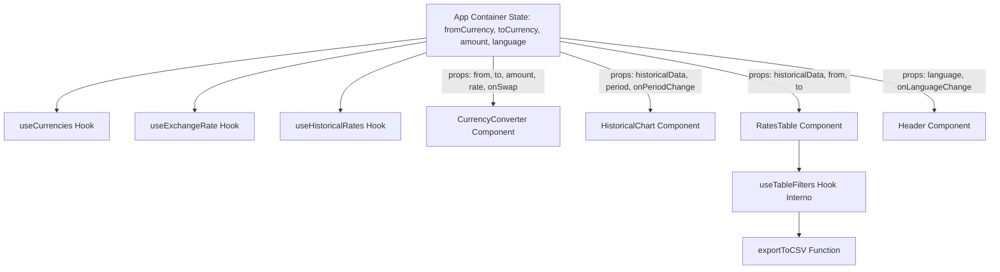

# Arquitetura e Mapeamento de Componentes — Currency Exchange App

Este documento detalha a divisão de responsabilidades, arquitetura de componentes React, props, estados, isolamento com CSS Modules e fluxo de dados (Lifting State Up e Custom Hooks).

---

## 1. Visão Geral da Arquitetura

A aplicação segue a metodologia de Componentes Funcionais com React Hooks, separando claramente:
- **Camada de Apresentação (UI Components):** Componentes visuais desacoplados e estilizados via CSS Modules.
- **Camada de Lógica e Estado (Custom Hooks):** Encapsulamento de chamadas à API, transformações de estado, paginação/filtragem e ciclo de vida.
- **Camada de Serviços (Services):** Funções puras em JavaScript para consumo HTTP com `fetch` e tratamento de erros da API Frankfurter.
- **Camada de Utilitários (Utils):** Funções matemáticas, formatação monetária (Intl), manipulação de datas e geração de arquivos CSV.

```
App.jsx (Container Principal e Gestor de Tema/Idioma)
 ├── Header.jsx (Logotipo Hermes, subtítulo e seletor de idiomas)
 ├── CurrencyConverter.jsx (Seleção de moedas, input de quantia, inversão e resultado)
 ├── HistoricalChart.jsx (Seletor de períodos 7D-10A, Recharts LineChart e métricas resumo)
 ├── RatesTable.jsx (Barra de filtros de data/cotação, contador, tabela ordenada e exportador CSV)
 └── Common / Feedback:
      ├── LoadingSpinner.jsx (Feedback visual de carregamento)
      ├── ErrorBanner.jsx (Avisos de erro de requisição com botão de retry)
      └── EmptyState.jsx (Exibição quando nenhum resultado bate com filtros)
```

---

## 2. Detalhamento dos Componentes

### 2.1. `App`
- **Arquivo JSX:** `src/App.jsx`
- **CSS Module:** `src/App.module.css`
- **Responsabilidade:** Orquestrador principal da aplicação. Gerencia o idioma ativo, estados globais de conexão e organiza a disposição em grid/layout editorial Hermes.
- **Props:** Nenhuma (Componente Raiz montado em `main.jsx`).
- **Estados Internos:**
  - `language`: Idioma selecionado (`'pt'`, `'en'` ou `'es'`).
  - `fromCurrency`: Moeda de origem selecionada (padrão `'USD'`).
  - `toCurrency`: Moeda de destino selecionada (padrão `'BRL'`).
  - `amount`: Valor monetário informado para conversão (padrão `1000`).

---

### 2.2. `Header`
- **Arquivo JSX:** `src/components/Header/Header.jsx`
- **CSS Module:** `src/components/Header/Header.module.css`
- **Responsabilidade:** Renderizar a barra superior com a marca institucional Hermes, descrição da ferramenta e controles de troca de idioma (PT | EN | ES).
- **Props:**
  - `language`: `string` — Idioma atual.
  - `onLanguageChange`: `(lang: string) => void` — Callback para alternar o idioma.
- **Estados:** Não possui estado local (componente controlado).

---

### 2.3. `CurrencyConverter`
- **Arquivo JSX:** `src/components/CurrencyConverter/CurrencyConverter.jsx`
- **CSS Module:** `src/components/CurrencyConverter/CurrencyConverter.module.css`
- **Responsabilidade:** Interface de entrada de dados financeiros. Permite escolher moedas de origem/destino, digitar o montante a ser convertido, acionar inversão e visualizar o resultado calculado com a cotação e data de referência.
- **Props:**
  - `fromCurrency`: `string` — Moeda de origem atual.
  - `toCurrency`: `string` — Moeda de destino atual.
  - `amount`: `number | string` — Montante numérico a converter.
  - `currencies`: `Array<{iso_code: string, name: string, symbol: string}>` — Lista de moedas válidas.
  - `exchangeRate`: `number | null` — Taxa unitária atual.
  - `rateDate`: `string | null` — Data de referência da cotação.
  - `isLoadingRate`: `boolean` — Indicador de busca de taxa em andamento.
  - `rateError`: `string | null` — Mensagem de erro caso a taxa falhe.
  - `language`: `string` — Idioma para textos.
  - `onFromChange`: `(code: string) => void` — Altera moeda de origem.
  - `onToChange`: `(code: string) => void` — Altera moeda de destino.
  - `onAmountChange`: `(value: number | string) => void` — Altera montante.
  - `onSwapCurrencies`: `() => void` — Dispara inversão do par de moedas.
- **Estados Internos:**
  - `validationError`: `string | null` — Armazena mensagem de validação (ex: valor negativo ou não numérico).

---

### 2.4. `HistoricalChart`
- **Arquivo JSX:** `src/components/HistoricalChart/HistoricalChart.jsx`
- **CSS Module:** `src/components/HistoricalChart/HistoricalChart.module.css`
- **Responsabilidade:** Apresentar a série temporal da taxa de câmbio entre o par selecionado. Contém o seletor de períodos (7D, 15D, 30D, 3M, 6M, 1A, 5A, 10A), resumo analítico (mínimo, máximo, média do período) e o gráfico interativo renderizado via biblioteca Recharts.
- **Props:**
  - `data`: `Array<{date: string, rate: number}>` — Array com dados da série histórica.
  - `fromCurrency`: `string` — Moeda de origem.
  - `toCurrency`: `string` — Moeda de destino.
  - `selectedPeriod`: `string` — Código do período selecionado (`'7d'`, `'15d'`, etc.).
  - `onPeriodChange`: `(period: string) => void` — Callback para alteração do período.
  - `isLoading`: `boolean` — Estado de carregamento do gráfico.
  - `error`: `string | null` — Erro de requisição da série histórica.
  - `language`: `string` — Idioma para legendas e formatação de datas.
- **Estados Internos:**
  - Cálculos derivados memoizados (`useMemo`): Cotação Mínima, Máxima, Média e Variação percentual do período.

---

### 2.5. `RatesTable`
- **Arquivo JSX:** `src/components/RatesTable/RatesTable.jsx`
- **CSS Module:** `src/components/RatesTable/RatesTable.module.css`
- **Responsabilidade:** Renderizar os dados históricos em tabela paginada/scrollável. Oferece barra de filtros (data inicial/final, taxa mínima/máxima), botões de ordenação por cabeçalho clicável, contador de itens filtrados e botão de exportação CSV.
- **Props:**
  - `data`: `Array<{date: string, base: string, quote: string, rate: number}>` — Dados brutos da série.
  - `fromCurrency`: `string` — Moeda de origem.
  - `toCurrency`: `string` — Moeda de destino.
  - `language`: `string` — Idioma atual.
  - `isLoading`: `boolean` — Estado de carregamento.
- **Estados Internos (gerenciados com o hook `useTableFilters`):**
  - `startDate`: `string` — Filtro de data inicial.
  - `endDate`: `string` — Filtro de data final.
  - `minRate`: `string` — Filtro de taxa mínima.
  - `maxRate`: `string` — Filtro de taxa máxima.
  - `sortField`: `'date' | 'rate'` — Coluna ativa de ordenação.
  - `sortDirection`: `'asc' | 'desc'` — Direção da ordenação.

---

### 2.6. Componentes Utilitários e de Feedback
- **`LoadingSpinner`** (`src/components/Common/LoadingSpinner.jsx`): Animação de carregamento elegante no tom verde Forest `#175F49`.
- **`ErrorBanner`** (`src/components/Common/ErrorBanner.jsx`): Card de aviso de falha na API com detalhes do erro e ação para tentar novamente.
- **`EmptyState`** (`src/components/Common/EmptyState.jsx`): Ilustração e mensagem quando a busca ou os filtros não retornam registros.

---

## 3. Mapeamento de Custom Hooks

| Hook | Arquivo | Responsabilidade |
| :--- | :--- | :--- |
| `useCurrencies` | `src/hooks/useCurrencies.js` | Busca a lista de moedas da API Frankfurter (`/v2/currencies`), gerencia cache em memória, loading e falha. |
| `useExchangeRate` | `src/hooks/useExchangeRate.js` | Dispara busca da taxa atual entre `from` e `to` (`/v2/rate/{base}/{quote}`). Recalcula e valida valores. |
| `useHistoricalRates` | `src/hooks/useHistoricalRates.js` | Constrói intervalo de datas de acordo com o período escolhido (7D a 10A) e consulta a série histórica na API. |
| `useTableFilters` | `src/hooks/useTableFilters.js` | Aplica filtros combinados de data e valor sobre a lista de cotações, ordena por campo/direção e prepara a lista final para renderização e exportação CSV. |

---

## 4. Fluxo de Dados e Lifting State Up


